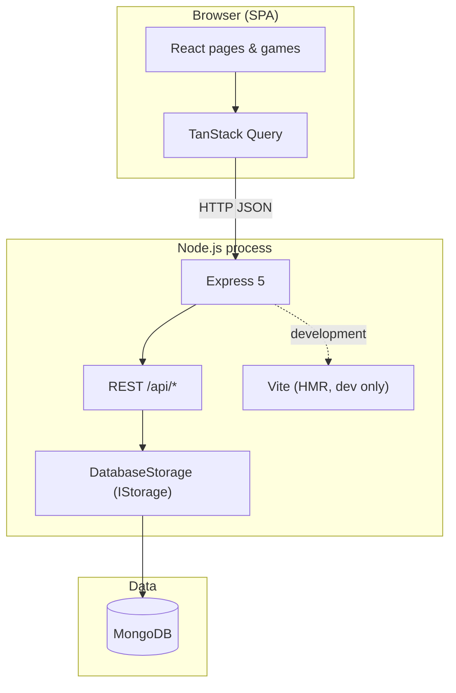
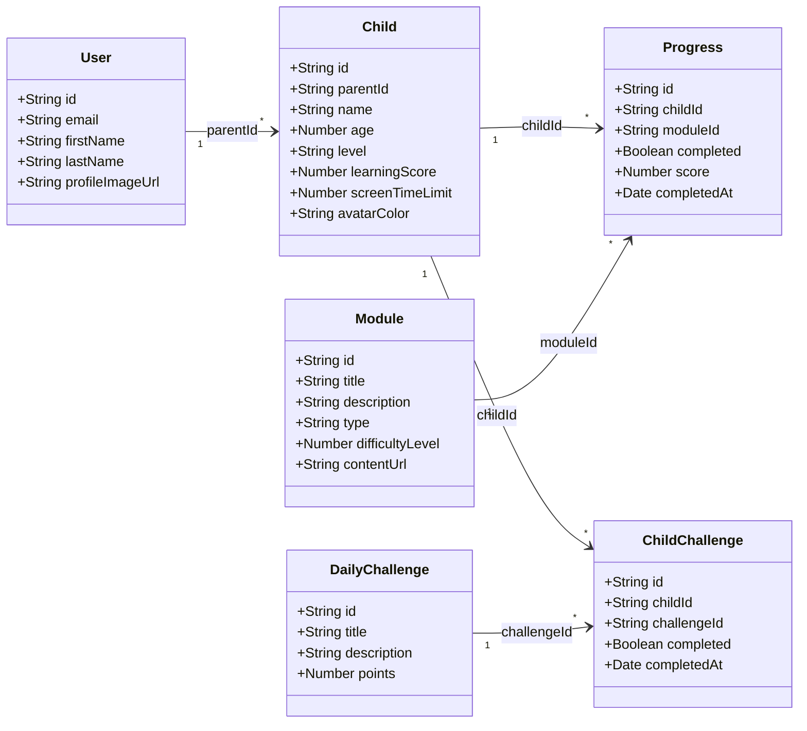
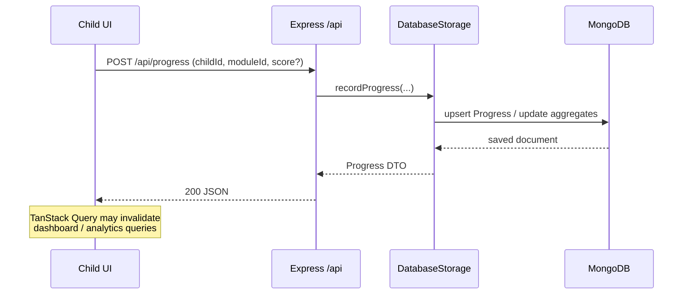

# TotsLearn (Learning Hub)

A full-stack web app for **early learning**: parents manage child profiles and view progress, children complete themed **modules** (games, stories, video-style content, drawing), and admins can curate **learning modules**. The same codebase serves the React UI and JSON APIs in development and production.

---

## What it does

| Audience                  | Capabilities                                                                                                                                                   |
| ------------------------- | -------------------------------------------------------------------------------------------------------------------------------------------------------------- |
| **Parent**                | Create and edit child profiles, view aggregated **analytics** (scores, completions, activity over time), and see per-child trends.                             |
| **Child**                 | Open a personalized dashboard, browse available modules by type/difficulty, play embedded activities, and **record progress** (completion and optional score). |
| **Admin / module editor** | Create learning **modules** (metadata + content URL) so the catalog stays curated.                                                                             |

Default modules can be **seeded** when the server starts so new environments are usable immediately.

---

## How it is built

### Stack

| Layer                  | Technology                                                 |
| ---------------------- | ---------------------------------------------------------- |
| UI                     | React 18, TypeScript, Vite                                 |
| Routing                | Wouter                                                     |
| Server state / caching | TanStack Query                                             |
| Styling                | Tailwind CSS, Radix UI primitives, shadcn-style components |
| API                    | Express 5, REST JSON under `/api/*`                        |
| Persistence            | MongoDB via Mongoose                                       |
| Contracts              | Shared Zod schemas and TypeScript types in `shared/`       |

### Monorepo-style layout

- `**client/`** — SPA: pages (`Landing`, `ParentDashboard`, `ChildDashboard`, `AdminDashboard`), hooks (`useAuth`), and game components under `client/src/components/games`.
- `**server/**` — HTTP server: `index.ts` wires Express, DB, routes; `routes.ts` registers REST handlers; `storage.ts` implements `IStorage` with `DatabaseStorage` for queries and analytics aggregation; `models.ts` defines Mongoose schemas.
- `**shared/**` — Single source of truth for **API shapes**: `schema.ts` (entities + Zod input schemas), `routes.ts` (documented endpoint contracts for client/server alignment).

### Runtime behavior

1. **Startup** — `server/index.ts` loads env, connects to MongoDB (`MONGODB_URI` required), then `registerRoutes()` mounts `/api` routes. In **development**, Vite is attached to the same HTTP server for HMR. In **production**, the prebuilt client is served as static assets.
2. **Auth** — Session-based flows vary by deployment (e.g. demo login vs. integrated auth). Route handlers enforce **role-appropriate access** (parent-only child CRUD, module editors for module creation, etc.).
3. **Data path** — Handlers validate input (often with Zod), call `DatabaseStorage`, and return JSON. The client uses TanStack Query to fetch and mutate remote state.

### Environment

| Variable      | Purpose                                                                 |
| ------------- | ----------------------------------------------------------------------- |
| `MONGODB_URI` | **Required.** MongoDB connection string.                                |
| `NODE_ENV`    | `development` vs `production` (Vite vs static, defaults).               |
| `PORT`        | HTTP port; dev default avoids common conflicts (see `server/index.ts`). |

### Scripts

| Command         | Description                                                |
| --------------- | ---------------------------------------------------------- |
| `npm run dev`   | Run the Express app with Vite middleware (development).    |
| `npm run build` | Build client (Vite) and bundle server (`script/build.ts`). |
| `npm start`     | Run the production bundle (`dist/index.cjs`).              |
| `npm run check` | TypeScript project check (`tsc`).                          |

---

## Architecture (UML)

The diagrams below use [Mermaid](https://mermaid.js.org/) syntax. They render on GitHub, in many IDEs, and in documentation viewers.

### Component view (deployment / layers)

### Domain model (class diagram)

High-level relationships mirror Mongoose models in `server/models.ts` and shared interfaces in `shared/schema.ts`.

### Sequence: child completes a module (simplified)

---

## Production and security notes

- Treat **demo / development auth** paths as non-production unless hardened (session secrets, `secure` cookies, HTTPS, real identity provider).
- Run behind TLS and set strong session configuration before exposing to the public internet.

---

## Further reading

- `docs/OOP_CONCEPTS.md` — supplementary notes on object-oriented ideas used in the codebase.

